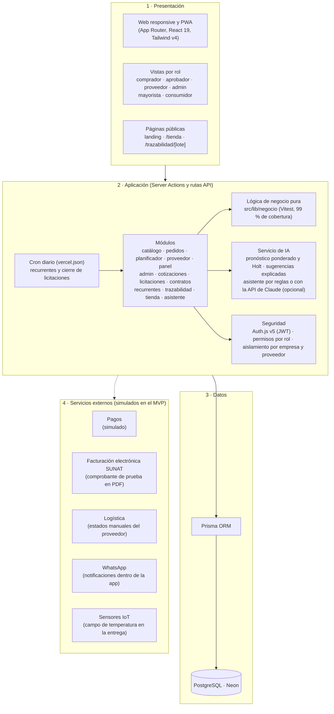
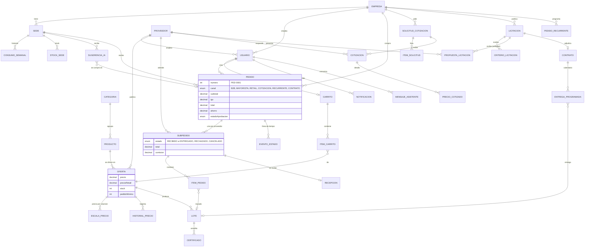

# Arquitectura de AbastIA

AbastIA es un **monolito modular** en Next.js 15: una sola aplicación desplegable con módulos de negocio separados por carpeta, una capa de lógica de negocio pura y una base PostgreSQL.

## Cuatro capas



### Cómo fluye una petición

1. El navegador llama a una **Server Action** (mutaciones) o a una **ruta API** (`/api/...`, para JSON, CSV y PDF).
2. El servidor obtiene la sesión con `requerirRol` / `requerirEmpresa` / `requerirProveedor` (`src/lib/sesion.ts`) y filtra **siempre** por `empresaId` o `proveedorId`. Ocultar botones nunca es la única barrera: un proveedor que pide por API un pedido ajeno recibe 403.
3. Los datos de entrada se validan con **zod** (los mismos esquemas que usan los formularios).
4. Los cálculos (precios, IGV, pronósticos, estados, puntajes) se hacen con las **funciones puras** de `src/lib/negocio`, que no dependen de React ni de Prisma.
5. Prisma persiste el resultado en una transacción y se crean las notificaciones.

`middleware.ts` (edge) redirige a `/login` y bloquea las áreas de otros roles antes de renderizar.

### Organización del código

```
src/
  app/                 rutas (páginas, layouts y API) por rol
  components/          ui (estilo shadcn) y componentes de la app (shell, barra, gráficos)
  lib/
    negocio/           lógica pura: ofertas, planificador, carrito, pedidos, proveedor,
                       fechas, hipótesis, licitación, validadores, asistente
    sesion.ts, permisos.ts, acciones.ts, api.ts, formato.ts, prisma.ts
  modules/<módulo>/    consultas.ts (lecturas), acciones.ts (Server Actions),
                       esquemas.ts (zod), servicio.ts (reglas con Prisma), componentes/
prisma/                schema.prisma, migraciones, datos.ts y seed.ts
tests/unit, tests/e2e  Vitest y Playwright
```

## Modelo entidad-relación



El modelo completo (34 tablas) está en [`prisma/schema.prisma`](../prisma/schema.prisma). El código visible `PED-XXXX` se deriva del número autoincremental, y el estado del pedido se deriva del subpedido menos avanzado (`estadoPedidoDerivado`).

## Por qué un monolito modular

- **Equipo pequeño y plazo corto.** Una sola base de código, un solo despliegue en Vercel y una sola base de datos reducen el costo de operar el MVP a casi cero.
- **Transacciones simples.** Crear un pedido con sus subpedidos, descontar stock, registrar sugerencias y notificar ocurre en una sola transacción de PostgreSQL, sin coordinación entre servicios.
- **Fronteras claras sin red de por medio.** Cada módulo (`src/modules/*`) expone consultas, acciones y esquemas, y la lógica de negocio vive aislada y probada en `src/lib/negocio`. Si un módulo crece (por ejemplo, el planificador con un modelo entrenado), se puede extraer como servicio sin reescribir el resto.
- **Rendimiento y SEO.** Los Server Components consultan la base directamente y envían HTML listo; no hace falta una API pública intermedia salvo donde se necesita (CSV, PDF, QR, cron).
- **Costo.** Vercel y Neon tienen capa gratuita suficiente para el piloto; los microservicios exigirían orquestación, colas y observabilidad que el MVP no necesita todavía.
